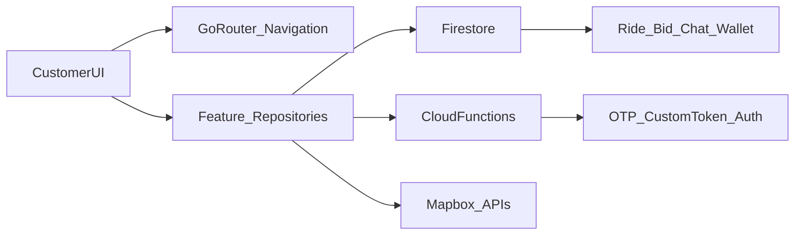

# CaRide Customer App Technical Documentation

This document describes the current production-oriented architecture of `apps/caride` (customer app), the backend contracts it depends on, and implementation notes that can guide future backend work for the driver domain.

## 1) Scope and Current App Identity

- App covered: `apps/caride` (customer/rider app).
- Driver app is a separate Flutter app (`apps/driver_app`) and is not implemented in this document.
- Backend model in use:
  - Firebase Authentication
  - Firestore
  - Cloud Functions (callable HTTPS)
  - Firebase Realtime Database (emulator wiring enabled, not actively used by app code)
  - Mapbox Geocoding + Directions APIs

## 2) App Architecture Overview

## 3) Key Entry and Routing Files

- App bootstrap:
  - `apps/caride/lib/main.dart`
  - `apps/caride/lib/core/firebase/firebase_bootstrap.dart`
  - `apps/caride/lib/core/config/app_env.dart`
- Router wiring:
  - `apps/caride/lib/router/customer_route_factory.dart`
  - `packages/navigation/lib/customer_router.dart`
  - `packages/navigation/lib/customer_route_paths.dart`

### 3.1 Route model (current)

- Main shell branches:
  - `/home`
  - `/chat`
  - `/activity`
  - `/profile`
- Fullscreen/standalone routes:
  - `/wallet`
  - `/wallet/fund`
  - `/ride/set-price`
  - `/ride/offers`
  - `/ride/select-driver`
  - `/ride/track`
  - `/ride/driver-tracking`
  - `/ride/share-receipt`

### 3.2 Ride flow path

- Home map selection -> `/ride/set-price` (renders ride type chooser)
- Ride type chooser -> `/ride/offers` (fare offering + ride request creation)
- Fare submission -> `/ride/select-driver`
- Driver chosen -> `/ride/track`

## 4) Environment and Runtime Configuration

`apps/caride/lib/core/config/app_env.dart` now supports runtime defines:

- `ENABLE_FIREBASE_EMULATOR` (bool)
- `FIREBASE_EMULATOR_HOST` (default `localhost`)
- `FIREBASE_AUTH_EMULATOR_PORT` (default `9099`)
- `FIREBASE_FIRESTORE_EMULATOR_PORT` (default `8080`)
- `FIREBASE_DATABASE_EMULATOR_PORT` (default `9000`)
- `FIREBASE_FUNCTIONS_EMULATOR_PORT` (default `5001`)
- `FIREBASE_FUNCTIONS_REGION` (default `us-central1`)
- `MAPBOX_ACCESS_TOKEN` (string, no in-code fallback token)

`firebase_bootstrap.dart` initializes Firebase and wires all emulator endpoints, including callable functions.

## 5) Backend Contract Inventory

## 5.1 Authentication

Repository:
- `apps/caride/lib/core/auth/auth_repository.dart`

Callable functions used:
- `requestEmailOtp`
  - request payload: `{ email, isSignUp }`
  - expected response fields: `{ challengeId, expiresAt }`
- `verifyEmailOtp`
  - request payload: `{ challengeId, code, email }`
  - expected response fields: `{ customToken }`

Firestore side effects:
- Creates/updates `users/{uid}` with:
  - `uid`, `email`, `role`, `isEmailVerified`, `profileCompleted`, timestamps

Error handling:
- Function exceptions are converted into `FirebaseAuthException` for unified UI error messaging.

## 5.2 Ride Booking and Bidding

Repository:
- `apps/caride/lib/features/ride_booking/data/ride_repository.dart`

Collections/documents:
- `rides/{rideId}`
- `bids/{rideId}/offers/{bidId}`
- `rideMessages/{rideId}`
- `rideMessages/{rideId}/messages/{messageId}`

Ride create payload (customer side):
- `customerUid`, `status`, `rideType`
- pickup/dropoff:
  - canonical: `pickupLabel`, `dropoffLabel`
  - compatibility aliases: `pickupName`, `dropoffName`
  - coordinates: `pickupLat`, `pickupLng`, `dropoffLat`, `dropoffLng`
- pricing/payment:
  - `customerOffer`, `amountNaira`, `paymentMethod`, `paymentStatus`
- timestamps:
  - `createdAt`, `updatedAt`

Bid acceptance updates:
- ride status -> `driverEnRoute`
- stores `driverUid`, `driverName`, `finalFare`, `amountNaira`
- writes `acceptedAt`, `updatedAt`
- initializes `rideMessages/{rideId}` thread with participants

Ride cancel and rating:
- cancel writes `status=cancelled`, reason, `cancelledAt`, `updatedAt`
- rating writes `driverRating`, `ratedAt`, `updatedAt`

## 5.3 Activity (Ride History)

Repository:
- `apps/caride/lib/features/profile/data/activity_repository.dart`

Read contract:
- source: `rides` filtered by `customerUid`, ordered by `updatedAt desc`
- compatibility behavior:
  - pickup/dropoff reads from `pickupLabel/dropoffLabel` first, then fallback `pickupName/dropoffName`
  - amount reads from `amountNaira`, fallback `customerOffer`, then `finalFare`

## 5.4 Addresses

Repositories:
- `apps/caride/lib/features/profile/data/address_repository.dart`
- `apps/caride/lib/features/home_map/data/home_repository.dart`

Unified collection:
- `users/{uid}/savedAddresses`

Fields:
- `label`, `address`, `createdAt`, `updatedAt`

## 5.5 Wallet and Payments

Repositories:
- `apps/caride/lib/features/profile/data/wallet_repository.dart`
- `apps/caride/lib/features/wallet/data/wallet_transaction_repository.dart`
- `apps/caride/lib/features/profile/data/payment_repository.dart`
- `apps/caride/lib/features/profile/data/card_repository.dart`

Callable functions:
- `initializePaystackTransaction`
- `verifyPaystackTransaction`

Validation:
- wallet function responses are parsed and validated via:
  - `apps/caride/lib/features/profile/data/wallet_response_parser.dart`

Collections:
- `walletTransactions` with `uid`, `type`, `amountNaira`, `createdAt`, etc.
- `users/{uid}/paymentMethods`
- `users/{uid}/savedCards`

## 5.6 Chat

Repository:
- `apps/caride/lib/features/chat/data/chat_repository.dart`

Collections:
- `rideMessages` (thread-level metadata)
- `rideMessages/{rideId}/messages` (chat messages)

Thread query:
- `participantUids array-contains uid`
- ordered by `lastMessageAt`

## 5.7 Pricing and Map Services

Repositories/services:
- `apps/caride/lib/features/ride_booking/data/ride_pricing_repository.dart`
- `apps/caride/lib/features/home_map/data/mapbox_search_service.dart`

External APIs:
- Mapbox Geocoding API
- Mapbox Directions API

Runtime behavior:
- 10-second request timeout
- safe fallback (`null` / empty list) on timeout/failure

## 6) What Was Improved for Live Readiness

- Routing:
  - fixed chat/wallet route collision
  - added canonical `/ride/select-driver`
  - aligned ride flow to select-driver step before track step
- Data consistency:
  - unified address collection to `savedAddresses`
  - ride writes now include compatibility fields (`pickupName`, `dropoffName`) and `updatedAt`
  - activity reads now support both legacy and canonical ride fields
- Runtime config hardening:
  - removed hardcoded Mapbox token from source
  - emulator wiring now includes Cloud Functions
- Repository safety:
  - centralized wallet response validation
  - auth callable failures mapped to consistent exceptions
- Cleanup:
  - removed unused/obsolete screens:
    - `features/ride_booking/set_price_screen.dart`
    - `features/wallet/fund_wallet_screen.dart`
    - `features/bidding/offers_screen.dart`
  - removed duplicate/unused Firebase options files from app `lib/`

## 7) Test Coverage Added

New tests:
- `apps/caride/test/wallet_repository_test.dart`
- `apps/caride/test/ride_data_mapping_test.dart`
- `apps/caride/test/ride_pricing_repository_test.dart`
- `apps/caride/test/mapbox_search_service_test.dart`

Coverage focus:
- Wallet parser validation and failure handling
- Ride data compatibility mapping
- Activity record mapping fallbacks
- Price-range computation
- Mapbox timeout and response parsing behavior

## 8) Runbook (Local)

From `apps/caride`:

1. `flutter pub get`
2. `flutter test`
3. `flutter analyze`
4. `flutter run`

Optional emulator run example:

`flutter run --dart-define=ENABLE_FIREBASE_EMULATOR=true --dart-define=MAPBOX_ACCESS_TOKEN=<token>`

## 9) Remaining Operational Requirements (External to Code)

- Firebase production security rules and indexes must exist and match queries.
- Cloud Functions for OTP and Paystack must be deployed and healthy.
- Android/iOS signing and secrets must be managed in CI/CD and platform config.
- Mapbox token lifecycle (dev/staging/prod separation) must be handled in deployment pipeline.

## 10) Backend API/Schema Checklist for QA

Before UAT:

- OTP request/verify succeeds with deployed callables.
- New user profile appears in `users/{uid}`.
- Ride request writes full document fields listed above.
- Driver bids can be accepted/countered/declined and status updates are reflected.
- Chat thread initializes on driver acceptance.
- Wallet top-up initialize/verify responses match parser expectations.
- Activity screen loads ride records without missing pickup/dropoff or amount due to schema mismatch.

## 11) Driver Backend Planning Guide (from Customer Contracts)

Even though this document is for the customer app, the same ride lifecycle should drive driver backend design.

### 11.1 Shared entities to formalize

- `Ride`
  - ownership: `customerUid`, `driverUid`
  - state machine: `requested -> bidding -> driverEnRoute -> rideStarted -> completed|cancelled`
  - pricing fields: `customerOffer`, `finalFare`, `amountNaira`
- `Bid`
  - driver identity + ETA + offer + expiry + counter-offer fields
- `RideMessageThread` and `Message`
- `WalletTransaction`

### 11.2 Strong recommendation for backend contract versioning

- Define canonical field names and keep aliases only during migration window.
- Add `schemaVersion` for ride documents.
- Introduce shared validation schema for both customer and driver writes.

### 11.3 Minimal Cloud Function set for driver-domain backend start

- `createDriverBid(rideId, offer, eta, vehicleMeta)`
- `respondToCounter(rideId, bidId, accepted|newOffer)`
- `updateRideStatus(rideId, nextStatus)` with allowed transitions
- `publishDriverLocation(rideId, lat, lng)` (if realtime tracking is required)
- `completeRide(rideId, fareBreakdown)`

### 11.4 Firestore index and rule planning

- Pre-create composite indexes for:
  - rides by `customerUid/updatedAt`
  - rides by `driverUid/updatedAt` (driver app requirement)
  - bids by `rideId/offerNaira` or `createdAt`
  - chat threads by participants and `lastMessageAt`
- Enforce role-based write permissions:
  - customer cannot write driver-only fields
  - driver cannot mutate customer-only fields
  - status transitions validated server-side

## 12) Known Risks and Suggested Next Phase

Known risks:
- Analyzer still reports two framework deprecation info items in top-up radio UI (non-blocking, not runtime failures).
- Production correctness still depends on backend-side rules/indexes and function logic.

Suggested next phase:
1. Add integration tests with Firebase emulator suite.
2. Add contract tests that validate callable response shapes in CI.
3. Build shared backend schema package used by both customer and driver apps.
4. Add driver app contract mirror document (`apps/driver_app`) once driver feature set is finalized.
