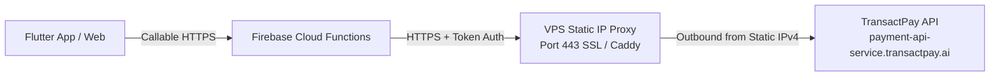

# CaRide TransactPay Static IP Proxy Service

A high-performance, secure reverse proxy built specifically to route TransactPay payment gateway requests from serverless Firebase Cloud Functions through a dedicated VPS with a static public IPv4 address.

---

## 1. Architecture Overview



- **Origin**: Firebase Cloud Functions uses dynamic Google Cloud IPs that rotate frequently and cannot be statically whitelisted.
- **Relay**: The proxy service is hosted on a VPS provisioned with a **dedicated static public IPv4 address**.
- **Destination**: TransactPay's API servers receive all incoming traffic exclusively from your VPS's static IPv4 address.

---

## 2. Whitelisted TransactPay Endpoints (Anti-Open-Proxy)

This proxy is strictly restricted to authorized TransactPay API routes. Any request targeting other endpoints or utilizing unauthorized HTTP methods is rejected with `403 Forbidden` or `405 Method Not Allowed`.

| Endpoint | Method | CaRide Service / Function |
|---|---|---|
| `/payment/order/create` | `POST` | `initializeBankTransfer` (Step 1: order creation) |
| `/payment/order/pay` | `POST` | `initializeBankTransfer` (Step 2: dynamic account issue) |
| `/payment/create` | `POST` | `initializeTransactPayTransaction` (Checkout payment link) |
| `/payment/order/status` | `POST` | `verifyTransactPayTransaction` (Transaction verification) |
| `/payment/banks` | `GET` | `listTransactPayBanks` (Bank list retrieval) |
| `/payout/name-enquiry` | `POST` | `resolveTransactPayBankAccount`, `saveDriverBankAccount` |
| `/payout/initiate` | `POST` | `processCustomerWithdrawal`, `processDriverWithdrawal` |

---

## 3. VPS Static IP Whitelisting Guide for TransactPay

### Step 1: Provision a VPS with a Dedicated Public IPv4

Deploy a minimal VPS (Ubuntu 22.04 or 24.04 LTS) with 1 vCPU and 1-2 GB RAM from any major cloud provider offering a static IPv4:
- **DigitalOcean**: Basic Droplet ($4 - $6/month) includes a dedicated static IPv4 address.
- **AWS Lightsail**: $3.50 - $5/month instance includes an attachable static public IPv4.
- **Linode / Akamai**: Shared CPU Nanode / 1GB ($5/month) with dedicated IPv4.
- **Hetzner Cloud**: CX22 (~€3.79/month) with primary IPv4.

### Step 2: Determine & Verify Your Static IPv4 Address

SSH into your VPS and execute:

```bash
curl -4 https://ifconfig.me
```
*(Alternative: `curl -4 https://api.ipify.org`)*

Copy the returned IPv4 address (e.g., `198.51.100.45`). This is your **VPS Static IP**.

### Step 3: Submit IP to TransactPay

Send an official IP whitelisting request to your TransactPay Account Manager / Support team:

> **Subject**: Production IP Whitelisting Request - CaRide
>
> **Body**:
> Hello TransactPay Team,
>
> Please whitelist our dedicated production server static IPv4 address for all API calls:
>
> - **Company / Merchant**: CaRide
> - **Merchant ID**: [Your TransactPay Merchant ID]
> - **Static Public IPv4**: `198.51.100.45` *(replace with your actual VPS IP)*
> - **Integration Endpoints**: Collections, Bank Transfer Orders, Name Enquiry, and Payout Transfers.
>
> Thank you!

---

## 4. Deployment Steps on the VPS

### Automated Deployment (Recommended)

1. Clone or copy the `services/transactpay-proxy` folder onto your VPS (e.g. at `/opt/caride/transactpay-proxy`):

```bash
sudo mkdir -p /opt/caride
cd /opt/caride
# Copy the files over SSH or git
```

2. Run the automated setup script:

```bash
cd /opt/caride/transactpay-proxy
chmod +x deploy/setup.sh
sudo ./deploy/setup.sh
```

The script will automatically:
- Detect and display your static IPv4 address.
- Configure UFW firewall (permits 22, 80, 443; closes 3000 to public).
- Install Docker and Docker Compose.
- Generate a 64-character random `PROXY_AUTH_TOKEN`.
- Build the Node.js Docker container.
- Launch the proxy service behind Caddy with automatic Let's Encrypt HTTPS SSL.

---

### Manual Deployment via Docker Compose

1. Copy `.env.example` to `.env`:
```bash
cp .env.example .env
```

2. Generate a secure auth token:
```bash
openssl rand -hex 32
```
Paste this token as `PROXY_AUTH_TOKEN` in `.env`.

3. Point your DNS domain (e.g. `proxy.caride.ng`) with an `A` record to your VPS static IPv4.

4. Edit `deploy/caddy/Caddyfile` and ensure your domain name is specified.

5. Start the stack:
```bash
docker compose up -d --build
```

---

## 5. Firebase Cloud Functions Configuration

Once your proxy is running with HTTPS, configure your Firebase Cloud Functions environment variables:

In `apps/caride/functions/.env`:

```env
# TransactPay API credentials
TRANSACTPAY_BASE_HOST=payment-api-service.transactpay.ai
TRANSACTPAY_PUBLIC_KEY=PGW-PUBLICKEY-YOUR-KEY
TRANSACTPAY_SECRET_KEY=PGW-SECRETKEY-YOUR-KEY
TRANSACTPAY_ENCRYPTION_KEY=YOUR_RSA_BASE64_KEY

# Static IP Proxy Configuration
TRANSACTPAY_PROXY_URL=https://proxy.caride.ng
TRANSACTPAY_PROXY_TOKEN=your_generated_64_char_proxy_auth_token
```

Deploy the updated Cloud Functions:

```bash
cd apps/caride/functions
npm run build
firebase deploy --only functions
```

---

## 6. Verification and Health Probing

### 1. Test Proxy Health
```bash
curl https://proxy.caride.ng/health
# Response: {"status":"healthy","uptimeSeconds":12,"timestamp":"..."}
```

### 2. Verify Static IP Diagnostics
```bash
curl https://proxy.caride.ng/vps-ip
# Response: {"configuredStaticIp":"...","detectedOutboundIp":"198.51.100.45","match":true}
```

### 3. Test Unauthorized Access (Must Fail)
```bash
curl -X POST https://proxy.caride.ng/payment/create -d '{"amount":100}' -H "Content-Type: application/json"
# Response: 401 Unauthorized ("Missing authentication token")
```

### 4. Test Anti-Open-Proxy Blocking (Must Fail)
```bash
curl -X POST https://proxy.caride.ng/unauthorized/path \
  -H "x-proxy-auth: your_token" \
  -H "Content-Type: application/json"
# Response: 403 Forbidden ("Path '/unauthorized/path' is not an authorized TransactPay endpoint")
```

### 5. Test Authorized Call through Proxy
```bash
curl -X GET https://proxy.caride.ng/payment/banks \
  -H "x-proxy-auth: your_token" \
  -H "api-key: your_transactpay_public_key"
```

---

## 7. Security & Hardening Features

- **Timing-Safe Auth Check**: Prevents timing side-channel attacks when verifying `x-proxy-auth`.
- **Strict Endpoint Allow-List**: Rejects any path or method not explicitly required for TransactPay operations.
- **In-Memory Rate Limiting**: Defaults to 120 req/min to protect against denial-of-service attempts.
- **PCI-DSS Logging Redaction**: Strips card PANs, CVVs, PINs, OTPs, and account numbers from log entries.
- **Streaming Forwarding**: Streams upstream HTTP response bodies to keep latency minimal.
- **Request Timeouts**: Enforces 30-second timeouts on all upstream calls.
- **Least-Privilege Docker**: Runs inside an unprivileged `node` user container on Alpine Linux.
